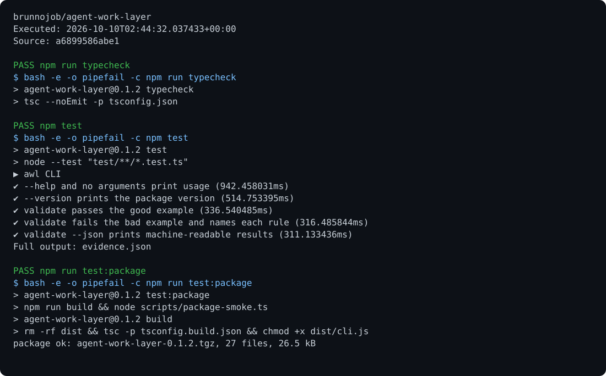

# agent-work-layer

**Work Orders and Work Reports for AI agents.** A typed SDK, validator, lifecycle engine and MCP server for handing work from one agent to another, with checkable results.

[](https://www.npmjs.com/package/agent-work-layer)
[](LICENSE)

- **Work Order** (manager → worker): the goal, how "done" is judged, budget, deadline, allowed tools.
- **Work Report** (worker → manager): the result, evidence for each criterion, actual cost, tools used.

Agent Cards say who an agent is. A2A carries messages between agents. MCP connects agents to tools. AWL describes **the job itself**, so any manager can hand work to any worker and check what came back. The format is defined in [SPEC.md](SPEC.md).

<p align="center"></p>

## How it works

1. A manager issues a **Work Order**: goal, criteria, budget, deadline, allowed tools.
2. A worker accepts it and does the job with its tools.
3. The worker returns a **Work Report** with evidence for every criterion and what it spent.
4. The desk checks the report against the order. The manager approves it or sends it back.

<p align="center"></p>

More diagrams: [message sequence](docs/sequence.svg) · [lifecycle](docs/lifecycle.svg) · [delegation](docs/delegation.svg)

## Install

```sh
npm install agent-work-layer
```

Node.js 20.11 or later. ESM only. Types included.

## Quick start

```ts
import { WorkDesk } from "agent-work-layer";

const desk = new WorkDesk(); // in-memory; use FileStore or your own DeskStore to persist

// Manager issues a job
const { order } = await desk.create(
  {
    to: "agent:researcher",
    goal: "Summarize the main risk factors in the latest annual report",
    criteria: [
      { id: "c1", text: "Lists three risk factors, each quoted from the filing" },
      { id: "c2", text: "States total debt and its fiscal year" },
    ],
    budget: { usd: 2, tool_calls: 20 },
    deadline: new Date(Date.now() + 3_600_000).toISOString(),
    tools: ["filings/*"],
  },
  "agent:manager",
);

// Worker accepts, does the work, reports with evidence
await desk.accept(order.id, "agent:researcher");
const { record } = await desk.submitReport(
  order.id,
  {
    status: "done",
    result: { summary: "Refinancing, customer concentration and FX risk. Debt 1.2B USD (FY2025)." },
    evidence: [
      { criterion: "c1", type: "tool_call", ref: "filings/get_section#3" },
      { criterion: "c2", type: "citation", ref: "filings/get_section#5" },
    ],
    cost: { usd: 0.84, tool_calls: 7 },
    tools_used: ["filings/search", "filings/get_section"],
  },
  "agent:researcher",
);

// Manager approves, or sends it back with a reason
await desk.review(order.id, "agent:manager", "approve");
```

The desk enforces the spec as you go:

- Who may do what: only the worker reports, and only the manager approves.
- Which state changes are legal.
- Evidence for every criterion.
- Only allowed tools.
- Cost within budget and finishing before the deadline. Going over either expires the order.
- Sub-orders can only narrow their parent's authority.

## Validate documents

```ts
import { validateOrder, validateReport, hasInvalid } from "agent-work-layer";

const findings = validateReport(report, order);
// [{ rule: "R4", kind: "invalid", path: "/evidence", message: 'no evidence for criterion "c2"' }, ...]
if (hasInvalid(findings)) reject(findings);
```

Every finding carries the rule id from [SPEC.md §7](SPEC.md#7-checks). `invalid` findings reject a document. `limit` findings (over budget, past deadline) are recorded and expire the order.

The JSON Schemas are exported too: `workOrderSchema`, `workReportSchema`, or `agent-work-layer/schemas/work-order.schema.json`.

## Run as an MCP server

Each agent session runs its own desk process. Sessions share one folder, and each is locked to one identity, so a worker cannot approve its own work.

```sh
# Claude Code: a manager session and a worker session, each added in its own project folder
claude mcp add awl -e AWL_STORE="$HOME/.awl" -e AWL_ACTOR=agent:manager -- npx -y agent-work-layer desk
claude mcp add awl -e AWL_STORE="$HOME/.awl" -e AWL_ACTOR=agent:worker  -- npx -y agent-work-layer desk
```

Tools: `create_work_order`, `list_work_orders`, `get_work_order`, `accept_work_order`, `decline_work_order`, `start_work_order`, `submit_work_report`, `answer_question`, `review_work_report`, `cancel_work_order`, `wait_for_update`.

To embed the server in your own process or transport:

```ts
import { WorkDesk, FileStore } from "agent-work-layer";
import { createDeskServer } from "agent-work-layer/mcp";

const server = createDeskServer({ desk: new WorkDesk({ store: new FileStore("./.awl") }), actor: "agent:manager" });
await server.connect(transport);
```

## CLI

```sh
npx agent-work-layer validate order.json report.json      # exit 1 on invalid, prints rule ids
npx agent-work-layer validate child.json --parent order.json
npx agent-work-layer validate order.json report.json --json
npx agent-work-layer schema order
npx agent-work-layer desk --store ./.awl --actor agent:worker
```

## Lifecycle

```
offered ──accept──▶ accepted ──start──▶ working ──report done/failed──▶ submitted ──approve──▶ approved
   │                                     │  ▲                              │
 decline                         blocked │  │ answer                       │ rework (with reason)
   ▼                                     ▼  │                              ▼
declined                                blocked                          working

Any active state ──cancel──▶ cancelled   ·   deadline or budget exceeded ──▶ expired
```

| Action | Who |
|---|---|
| accept, decline, start, submit report | the worker (`order.to`) |
| approve, rework, cancel | the manager (`order.from`) |
| answer a blocked worker | the manager or `order.escalate_to` |
| expire | the desk |

## API

| Export | Purpose |
|---|---|
| `WorkDesk` | Runs the lifecycle: `create`, `accept`, `decline`, `start`, `submitReport`, `answer`, `review`, `cancel`, `get`, `list`, `waitForChange` |
| `MemoryStore`, `FileStore`, `DeskStore` | Storage. Implement `DeskStore` (4 methods) to use a database |
| `validateOrder`, `validateReport`, `validateChildOrder`, `hasInvalid` | Spec checks, returning `Finding[]` |
| `isWorkOrder`, `isWorkReport` | Type guards |
| `toolAllowed`, `patternCovered` | Tool pattern matching |
| `nextState`, `allowedActions`, `STATES`, `ROLE_FOR`, `isTerminal` | The state machine |
| `AwlError`, `isAwlError` | Typed errors with `code` and `findings` |
| `createDeskServer` (from `agent-work-layer/mcp`) | MCP server for a desk |

`WorkDesk` options: `store`, `clock` (for tests), `newId`, `onEvent(event, record)` (webhooks, logging, metrics).

### Error codes

`NOT_FOUND`, `ALREADY_EXISTS`, `FORBIDDEN`, `INVALID_TRANSITION`, `VALIDATION_FAILED` (with `findings`), `CONFLICT` (a concurrent writer got there first; re-read and retry), `BAD_REQUEST`.

### Custom storage

```ts
import type { DeskStore, OrderRecord } from "agent-work-layer";

class PostgresStore implements DeskStore {
  async read(id: string): Promise<OrderRecord | null> { /* SELECT */ }
  async insert(record: OrderRecord) { /* INSERT, throw AwlError("ALREADY_EXISTS") on conflict */ }
  async update(record: OrderRecord, expectedSeq: number) { /* UPDATE ... WHERE last_seq = expectedSeq, else AwlError("CONFLICT") */ }
  async list() { /* SELECT */ }
}
```

## Production notes

The desk trusts the `actor` it is given. In production, derive the actor from authentication, not from tool arguments. For real-time enforcement, check `tools` and `budget` at each tool call in an MCP gateway, not only when the report arrives. See [SPEC.md §10](SPEC.md#10-security).

## Development

```sh
npm install
npm test               # unit, integration and end-to-end tests
npm run test:coverage
npm run typecheck
npm run test:package   # builds, packs, installs the tarball in a clean project and uses it
npm run check          # all of the above; runs automatically before npm publish
```

## Contributing

Issues, ideas and pull requests are welcome. See [CONTRIBUTING.md](CONTRIBUTING.md) and the [roadmap](ROADMAP.md). Spec changes start as a **Spec proposal** issue.

## License

[Apache-2.0](LICENSE). You can use, modify and ship it, including commercially. The license includes a patent grant.

## Implementation update

FileStore inserts use unique temporary files and an atomic hard-link operation: concurrent writers cannot both create the same order. Temporary files are cleaned up after success or failure. Updates retain the documented best-effort cross-process revision check. Run `node --experimental-transform-types --test tests/insert-race.test.ts`.

Credits for this fork's updates: [brunnodev.store](https://brunnodev.store). Original authors retain their respective attribution.

Contribution trailer: `Co-authored-by: nyctophile <33561761+ineedfoundmyway@users.noreply.github.com>`.

## Execution proof

[](https://github.com/brunnojob/agent-work-layer/actions/workflows/proof.yml)



[Verified run](https://github.com/brunnojob/agent-work-layer/actions/runs/38018059323) · [Execution report](docs/proof/evidence.json)

Run `python .proof/record.py` after installing the prerequisites above. The scenarios execute repository code and verify exit codes and expected output. CI publishes `execution-proof` with the transcript, input fingerprints and source commit. The downloadable report identifies the exact tested version; the workflow badge tracks the latest run.
